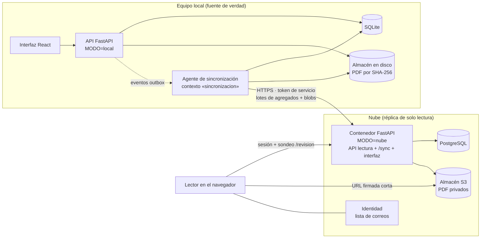

# Plan · Matriz, PDF y visor en la nube (solo lectura) con sincronización automática

- Estado: **propuesto** · Fecha: 2026-11-24 · Responsable: Pablo Andrés Erazo Muñoz
- Decisión asociada: `docs/decisiones/0009-nube-solo-lectura-y-sincronizacion.md`
- Tallas de esfuerzo: **S** ≤ 1 día · **M** 2–4 días · **L** ≥ 1 semana (una persona, con pruebas)

## 1. Qué se pide y qué no

**Ahora (Fases 0–2):** ver en la nube la matriz, los PDF y el visor con resaltado de citas; solo lectura; cada cambio
hecho en local se refleja solo; un panel de configuración para definir a qué nube se sube; sin Claude.

**Después (Fases 3–4):** extraer con Claude desde la nube. Este plan no lo construye, pero impide cerrarle la puerta
(sección 10).

**Fuera de alcance:** edición desde la nube, varios proyectos de varios dueños, aplicación móvil, dominio propio
(decisión abierta, sección 13).

## 2. Punto de partida: lo que el código ya resuelve y lo que no

| Hallazgo en el código | Consecuencia para el plan |
|---|---|
| `AlmacenDeArchivos` es un puerto con 3 adaptadores; `AlmacenS3` ya genera URL firmadas y `GET /articulos/{id}/pdf` ya redirige a ellas (`biblioteca/api.py:78`) | El PDF en la nube casi no requiere código nuevo. |
| Los PDF se guardan por SHA-256 (`huella_sha256`, clave `pdf/<proyecto>/<sha>.pdf`) | Subida idempotente y deduplicada: `HEAD` por hash y solo se envía lo que falta. |
| IDs son UUID y todo lleva `proyecto_id` | Se puede replicar sin renumerar y escalar a varios proyectos. |
| Hay outbox transaccional con eventos (`CeldaAprobada`, `FilaEscrita`, `ArticuloConvertido`, …) | Sirve de **disparador**, no de fuente de verdad (la CLI y las migraciones escriben sin pasar por la API). |
| `JsonB` cae a JSON en SQLite y a JSONB en PostgreSQL; `psycopg` y `boto3` ya son dependencias | La nube puede ser PostgreSQL sin reescribir modelos. **Nunca se ha corrido el código en PostgreSQL** (ADR 0003, «queda sin probar»; el CI solo usa SQLite). Es el riesgo n.º 1. |
| La API sirve la interfaz compilada en `/` (`main.py:78`) y la interfaz llama a `/api/v1` relativo | La nube es **un solo contenedor** con la misma imagen: sin CORS, sin segundo despliegue del front. |
| `seguridad.usuario_actual` devuelve siempre el administrador local; ADR 0007 pide reabrir la decisión si se comparte | La nube **no puede** reutilizar esa dependencia: hay que añadir identidad real en modo nube. |
| `despachador_en_servidor` y el ejecutor de extracciones corren en hilos dentro de la API | En la nube de solo lectura se apagan; la API queda sin estado y puede escalar horizontalmente. |
| La interfaz mezcla controles de escritura y servicios locales (extraer, cargar, restablecer, aprobar, monitor de Claude, MinerU, registro) | Hace falta un contrato `GET /api/v1/capacidades` para que el visor oculte lo que no aplica. |
| `pdfjs.getDocument({ withCredentials: true })` (`VisorPdf.tsx:15`) | Con redirección a un bucket de otro dominio, el navegador exige CORS con credenciales y falla. En modo nube va `false` y el bucket lleva CORS para el origen del visor. |
| Volumen real: 79 filas, 4 661 celdas, 53 PDF (35 MB), ~18 MB de JSON; crudo de MinerU 24 MB | Sin problema de escala; el manifiesto completo cabe en decenas de KB. No se optimiza antes de tiempo. |

## 3. Principios

1. **Local primero.** La app local nunca espera ni falla por la nube. La sincronización es un hilo de fondo con reintentos.
2. **Un solo escritor por agregado.** Hoy es el equipo local; no hay conflictos que resolver.
3. **Disparar por eventos, reconciliar por contenido.** Los eventos dicen «mira ahora»; la verdad la dan los hashes.
4. **Mismo código, dos modos** (`MODO=local|nube`), una imagen.
5. **Contenido direccionado por hash** para todo archivo.
6. **Seguridad que falla cerrada** y mínimo privilegio (el token que escribe no lee; quien lee no escribe).
7. **No construir lo que no se usa**: las costuras para Claude se dejan, el motor no.

## 4. Arquitectura objetivo



Fase 3 (futuro) añade a la derecha un **worker de extracción** y un **servicio de conversión** que leen la cola de
PostgreSQL; la API de la nube pasa de réplica a escritora solo cuando el proyecto cambia de sede (sección 10).

## 5. Modelo de sincronización

### 5.1 Qué viaja y qué no

| Agregado | Origen local | Viaja | Nota |
|---|---|---|---|
| Proyecto | `proyectos` | Sí | nombre + id |
| Libro de códigos | `normas_versiones_libro` | Sí (todas las versiones) | la interfaz lee columnas y vocabularios de la versión activa |
| Artículo | `biblioteca_articulos` | Sí | estado, página, motivo de exclusión |
| PDF | almacén `pdf/…` | Sí (blob) | por SHA-256, antes que el artículo |
| Documento estructurado | `biblioteca_documentos` (8,9 MB) | Sí | lo usa `/articulos/{id}/documento` para anclar y resaltar |
| Fila y sus celdas | `matriz_filas` + `matriz_celdas` | Sí, **como un solo agregado** | evidencias, inferencia, historial de revisión |
| Resumen de extracción | `extraccion_extracciones` | Solo campos de lectura (estado, modelos, acuerdos, fechas) | `salida` y `anclas` completas (4 MB) quedan en local; interruptor en el panel |
| Excel base de la matriz | `matriz_bases` + blob | Opcional (apagado) | solo si se habilita «Exportar» en la nube |
| Crudo de MinerU (`crudo/*.zip`, 24 MB) | almacén | Opcional (apagado) | no lo usa el visor; es respaldo costoso de regenerar |
| Cola de extracción, outbox, usuarios, registro, bases `.db` antiguas | — | **No** | estado local |

### 5.2 Sobre de réplica (contrato versionado)

```json
{ "esquema": 1, "tipo": "fila", "id": "<uuid>", "proyecto_id": "<uuid>",
  "hash": "sha256:…", "eliminado": false, "datos": { … agregado completo … } }
```

- `hash` = SHA-256 del JSON canónico de `datos` (claves ordenadas, sin espacios, sin campos del transporte). Dos
  máquinas que describen lo mismo producen el mismo hash; por eso el reenvío es inocuo.
- Cada contexto aporta `a_replica()` y `de_replica()` en sus adaptadores (la fila reutiliza `_volcar_celda` /
  `_celda_a_dominio`). El contexto `sincronizacion` **no lee tablas ajenas**: pide los sobres a cada contexto por su
  puerto, y el único lugar que los conecta sigue siendo `app/composicion.py`.
- `esquema` es el contrato. Si la nube no lo soporta responde **426**; el panel muestra «actualice la nube».

### 5.3 Algoritmo del agente (local)

```
disparadores:  evento de outbox (agrupados 5 s)  |  temporizador (10 min)  |  arranque de la app  |  botón «Sincronizar ahora»

pasada(proyecto):
  1. local  = { (tipo,id): hash }            # sobres de todos los agregados activos
  2. nube   = GET /sync/manifiesto            # { revision, items: {tipo: {id: hash}} }
  3. faltan = local − nube (hash distinto o ausente);  sobran = nube − local → eliminado:true
  4. blobs: para cada PDF de `faltan` →  HEAD /sync/blobs/{sha}; si no existe, subir (URL firmada) y verificar hash
  5. enviar `faltan` y `sobran` en lotes ≤ 2 MB, en orden de dependencia:
        libro → artículo(+documento) → fila(+celdas) → resumen de extracción
  6. verificar: GET /sync/manifiesto debe coincidir con el local; registrar la corrida
  error de red → reintento con espera creciente (5 s … 10 min); nunca bloquea la app local
```

Consecuencias de diseñarlo así:

- **Autorreparable**: nube vacía, restaurada de una copia o con una pasada cortada a medias → la siguiente pasada la
  completa sin lógica especial.
- **Cubre lo que los eventos no ven**: `importar-matriz`, `migrar-libro` y la CLI escriben en SQLite sin pasar por la
  API; el temporizador y el arranque lo detectan.
- **Sin tabla de «lo enviado»** en local: la nube es la referencia, así no hay dos contabilidades que se desincronicen.
- Con 79 filas y 4 661 celdas calcular todos los hashes es trabajo de una fracción de segundo (por medir en 1.5). Si
  algún día hay >5 000 agregados se añade un filtro por `actualizado_en`; antes no.

### 5.4 Protocolo en la nube (solo `MODO=nube`)

| Método y ruta | Quién | Qué hace |
|---|---|---|
| `GET /api/v1/sync/manifiesto?proyecto=` | token de servicio | hashes por agregado + `revision` |
| `HEAD /api/v1/sync/blobs/{sha256}` | token de servicio | ¿existe el PDF? |
| `POST /api/v1/sync/blobs/{sha256}` | token de servicio | devuelve URL firmada de subida; la nube verifica el hash |
| `PUT /api/v1/sync/lote` | token de servicio | aplica hasta N sobres en **una transacción**; cabecera `Idempotency-Key`; responde aceptados/rechazados y la nueva `revision` |
| `GET /api/v1/revision` | lector | entero que sube con cada lote aplicado; con `ETag` |
| `GET /api/v1/capacidades` | lector | `{modo:"nube", escritura:false, servicios_locales:false, exportar:…}` |
| Todas las rutas de escritura de dominio | — | **405** en modo nube |

El `PUT /lote` llama a los casos de uso de importación de cada contexto (a través de `composicion.py`); no escribe
tablas ajenas. Aplica solo si `hash` difiere y rechaza un `esquema` desconocido.

### 5.5 Garantías y fallos

| Situación | Comportamiento |
|---|---|
| Sin internet | La app local sigue normal; el panel muestra «N cambios pendientes»; reintenta solo. |
| Corte a mitad de una pasada | Los lotes son transaccionales y los PDF van antes que sus artículos: la nube nunca muestra un artículo sin su PDF. La siguiente pasada completa. |
| Mismo lote dos veces | Idempotente (`hash` + `Idempotency-Key`). |
| Se borra una fila (`reemplazar` al importar, exclusión) | El agente la manda con `eliminado:true`; la nube la quita. |
| La nube cambia de esquema antes que el local | Se despliega primero la nube; es compatible hacia atrás (expandir/contraer). |
| El local migra antes que la nube (p. ej. otra versión del libro) | La nube responde 426 y el panel lo explica; no se pierde nada. |
| Se restaura la base de la nube desde una copia | La reconciliación reenvía lo que falte. |
| Dos equipos locales sincronizan el mismo proyecto | Se impide: el destino guarda `sede` y el `id` de instalación; el segundo recibe 409. |

### 5.6 Visor «vivo»

El visor consulta `GET /api/v1/revision` cada 15 s (con `ETag`: respuesta vacía si no cambió). Si el número subió,
invalida las consultas de `react-query` y se redibuja. Muestra «Actualizado hace 12 s · revisión 345» y un aviso si la
nube lleva más de 15 min sin recibir nada. Latencia esperada local → visor: **≤ 30 s** (5 s de agrupación + subida +
15 s de sondeo). Server-Sent Events es una mejora de la fase 2 y es lo que se reutilizará para mostrar el avance de
Claude en la fase 3.

## 6. Panel de configuración (interfaz local, «Configuración › Nube»)

Disponible solo en modo local. Cinco bloques:

1. **Destino** — perfil: *Nube propia (recomendado)* · *Carpeta sincronizada (solo respaldo de exportaciones)* ·
   *Desactivado*. Campos del primero: **URL de la nube**, **Token de sincronización** (campo oculto), nombre del
   proyecto en la nube, enlace **«Abrir visor»**. Botón **Probar conexión**: comprueba URL, token, versión de esquema,
   espacio y devuelve qué falló, no solo «error».
2. **Qué se sube** — interruptores: PDF (sí), documento estructurado (sí, el visor lo necesita), matriz y evidencias
   (sí), historial de revisiones (sí), resumen de extracción (sí), extracción completa (no), Excel base (no), crudo de
   MinerU (no).
3. **Cuándo** — Automático (sí) · agrupar cambios durante (5 s) · reconciliar cada (10 min) · **Pausar**.
4. **Estado** — indicador permanente en la cabecera (junto al monitor de servicios): `✔ Sincronizado hace 8 s`,
   `↻ Subiendo 3 de 12`, `⚠ Sin conexión · 4 cambios pendientes`, `✖ Error: …`. Tabla de las últimas corridas (hora,
   motivo, enviados, omitidos, bytes, duración, error). Botones: **Sincronizar ahora**, **Verificar integridad**
   (compara manifiestos y lista diferencias), **Reenviar todo**.
5. **Acceso** (fase 2) — rotar el token, ver y editar la lista de lectores permitidos.

Reglas del panel:

- El token se guarda en el **almacén de credenciales del sistema** (Windows Credential Manager, paquete `keyring`),
  indexado por `proyecto_id`. La API local **nunca** lo devuelve: solo `configurado: true` y «Reemplazar».
- La configuración no secreta vive en la base local (`sync_destinos`), así los conjuntos *principal* y *test* no se
  mezclan: cada base apunta a su propio destino.
- Endpoints locales: `GET/PUT /api/v1/sincronizacion/ajustes`, `POST …/probar`, `POST …/ahora`, `POST …/verificar`,
  `GET …/estado`, `GET …/corridas`. Tablas nuevas con su migración Alembic: `sync_destinos`, `sync_corridas`.
- Un destino mal configurado o una nube caída **nunca** impide abrir ni usar la app.

## 7. Seguridad

| Tema | Decisión |
|---|---|
| Lectores | Inicio de sesión con proveedor de identidad (correo de la lista permitida). Rol `lector`. Sin cuenta, la API responde 401 y la interfaz muestra la pantalla de acceso. |
| Agente | Token de servicio aparte, con permiso solo para `/sync/*`. Se guarda hasheado en la nube; rotable. |
| Falla cerrada | `MODO=nube` no arranca si falta el proveedor de identidad o el token. La dependencia que da el «administrador local» no se registra en modo nube. |
| PDF | Bucket privado; URL firmada de ≤ 15 min por solicitud; sin enlaces públicos; CORS solo para el origen del visor. |
| Derechos de autor | Los PDF son artículos de terceros: mantener la nube privada y limitada a la lista de lectores (asesores, jurados). Compartir enlaces abiertos puede violar licencias de las editoriales. |
| Secretos | Variables de entorno en el proveedor; nada en el repositorio. Local: `keyring`. Nunca se registran en logs ni en el panel. |
| Copias | Versionado del bucket y copias automáticas de PostgreSQL con recuperación a un punto en el tiempo. |
| Transporte | Solo HTTPS; el agente rechaza URL `http://` salvo `localhost`. |

## 8. Proveedores (a decidir; el diseño no depende de uno)

El diseño solo exige: un contenedor, PostgreSQL, un bucket S3-compatible y un proveedor de identidad.

| Perfil | Composición | Cuándo conviene |
|---|---|---|
| **A (recomendado)** | **Supabase** (PostgreSQL + Storage con API S3 + Auth) + **Render** (contenedor desde GitHub) | Mínimo trabajo: Auth, base y bucket en un panel; despliegue automático al hacer `push` a `main`. |
| B | **Fly.io** (contenedor + PostgreSQL + Tigris S3) con Auth por correo propio | Un solo proveedor; algo más de operación. |
| C | Google Cloud Run + Cloud SQL + Cloud Storage + Identity Platform | Si el grupo ya tiene proyecto en GCP; más caro y más configuración. |

Notas de oficio (verificar precios y límites vigentes antes de contratar): los planes gratuitos suelen **pausar o
dormir** el servicio y la base tras un tiempo sin uso, lo que arruina un visor «siempre disponible»; para el visor
conviene el plan de pago más bajo. Con el pool de conexiones de Supabase (modo transacción) hay que abrir
`psycopg` con `prepare_threshold=None`. El despliegue continuo desde el repositorio `Zann181/calificar` puede
usar el mismo flujo de `ci.yml`.

## 9. Fases

### Fase 0 · Cimientos y pruebas de riesgo (esfuerzo total: M)

| # | Tarea | Talla | Hecho cuando |
|---|---|---|---|
| 0.1 | Añadir al CI un job con PostgreSQL 16 (servicio) y correr `alembic upgrade head`, `alembic check` y `pytest` contra él | M | CI verde en ambos motores; los fallos de JSONB / índice parcial quedan arreglados |
| 0.2 | Ajuste `MODO` (`local`\|`nube`) en `config.py`; en nube: `despachador_en_servidor=False`, sin ejecutor, sin `usuario_actual` local | S | arranque en nube sin hilos de fondo; en local nada cambia |
| 0.3 | Dockerfile único (backend + `frontend/dist`), variables por entorno, migraciones al arrancar | S | `docker run` sirve la interfaz y `/api/v1/salud` |
| 0.4 | Decidir proveedor y lista de lectores (sección 13) | S | ADR 0009 aprobado |

### Fase 1 · Nube de solo lectura + sincronización (esfuerzo total: L)

| # | Tarea | Talla | Aceptación |
|---|---|---|---|
| 1.1 | **Modo nube de solo lectura**: rutas de escritura → 405; `GET /capacidades`; la interfaz oculta extraer, cargar, restablecer, aprobar/corregir/rechazar, monitor de Claude, estado de servicios y registro | M | recorrido completo del visor en nube sin ningún botón de escritura |
| 1.2 | **Identidad de lectores** en nube + token de servicio; falla cerrada | M | sin sesión → 401; token de servicio no puede leer; lector no puede escribir; sin IdP no arranca |
| 1.3 | **Contrato de réplica**: `a_replica()/de_replica()` por contexto, hash canónico, `esquema: 1` | M | ida y vuelta idéntica (extiende `test_ida_y_vuelta_matriz`) |
| 1.4 | **Ingesta en nube**: `manifiesto`, `blobs`, `lote`, `revision` | M | idempotente; transaccional; 426 con esquema desconocido |
| 1.5 | **Agente local** (contexto `sincronizacion`: dominio/aplicación/puertos/adaptadores, hilo con la outbox, reintentos con espera creciente) + migración de `sync_destinos` y `sync_corridas` | L | pasada completa de 79 filas y 53 PDF; segunda pasada = 0 envíos |
| 1.6 | **Panel de configuración** y indicador de cabecera (sección 6) | M | probar conexión, sincronizar, verificar y pausar funcionan; el token no aparece en ninguna respuesta |
| 1.7 | **Visor vivo**: sondeo de `/revision`, aviso de actualización, `withCredentials:false` y CORS del bucket en nube | S | aprobar una celda en local aparece en el visor en ≤ 30 s |
| 1.8 | **Despliegue** en el proveedor elegido, copias y vigilancia de `/salud` | M | URL privada operativa; restauración de la base probada una vez |
| 1.9 | **Publicación inicial** de la base principal (y, si se quiere, del conjunto de test como proyecto aparte) | S | manifiestos iguales, 0 diferencias |

Entrega mínima útil: 1.1 + 1.2 + 1.3 + 1.4 + 1.5 con la configuración por archivo; el panel (1.6) llega justo después.

### Fase 2 · Endurecer y ampliar la lectura (M–L, cuando haga falta)

- Varios lectores con invitación y baja desde el panel; registro de accesos.
- Server-Sent Events en lugar del sondeo; caché de PDF por CDN con URL firmada.
- Respaldo del crudo de MinerU y de las extracciones completas; **«Descargar proyecto desde la nube»** (restauración
  local, hoy inexistente).
- Observabilidad: métricas de la pasada de sincronización, alerta si la nube lleva > N min sin recibir.
- Paginación y búsqueda en servidor (hoy la interfaz pide `tam=500` fijo en `api.filas`).

### Fase 3 · Claude en la nube (futuro; solo se enumera lo que obliga a decidir)

- **Reabrir ADR 0002**: la CLI `claude -p` con sesión iniciada no existe en un contenedor; habrá que usar clave de API
  o el SDK de agentes, con tope de gasto (ADR 0005 y `tope_tokens_mensual`).
- **Worker de extracción** que consume `extraccion_cola` (ya en base) con `FOR UPDATE SKIP LOCKED`, o Dramatiq+Redis
  (ya en `pyproject.toml`). La prueba de concurrencia que el ADR 0007 descartó vuelve a aplicar.
- **MinerU** necesita su propio servicio (11–21 s por página en CPU, ~7,7 GB de RAM en el equipo actual): contenedor
  aparte, probablemente con GPU, o API de conversión externa.
- **Versión optimista por fila** (`version` en `matriz_filas`) y `sede` por proyecto, para impedir doble escritura.

### Fase 4 · Cambio de sede (futuro)

Operación explícita «Mover la sede a la nube»: el local hace una última pasada, marca `sede = nube` con una valla de
`revision`, y desde ahí la nube es la escritora y el local pasa a réplica de lectura (o a copia de respaldo). Se evita
la fusión bidireccional; el costo es que solo un lado escribe a la vez.

## 10. Costuras que se dejan ya para Claude en la nube

| Costura | Estado | Qué falta |
|---|---|---|
| IDs UUID y `proyecto_id` en todo | ya existe | nada |
| Blobs por contenido y puerto `AlmacenDeArchivos` con S3 | ya existe | nada |
| Outbox como cola de trabajo | ya existe | worker (fase 3) |
| `extraccion_cola` en la base | ya existe | consumirla desde otro proceso |
| API sin estado en modo nube | fase 0.2 | — |
| `sede` por proyecto (`local` único valor permitido hoy) | fase 1.5, en `sync_destinos` | permitir `nube` (fase 4) |
| Identidad de usuario en `autor` de cada revisión | ya existe (correo) | mapear el correo del IdP |
| `version` por fila para concurrencia optimista | **no se agrega ahora** | fase 3, con su ADR |

## 11. Pruebas

Siguiendo la cultura del repositorio (pruebas doradas, sin modelo real, `import-linter`):

1. **Paridad local/nube (la prueba central).** Con una base local sembrada, se sincroniza hacia una nube de prueba
   (`TestClient` + SQLite en memoria; el CI de la fase 0 añade PostgreSQL) y se comparan las respuestas JSON de
   `/matriz/filas`, `/celdas/{clave}`, `/articulos`, `/documento` y `/normas/columnas`: deben ser **idénticas**.
2. **Idempotencia:** dos pasadas seguidas → la segunda no envía nada; mismo lote con la misma `Idempotency-Key` → mismo resultado.
3. **Recuperación:** pasada cortada a mitad, nube vaciada, nube con una fila alterada → la pasada siguiente deja
   manifiestos iguales.
4. **Borrado:** una fila reemplazada/excluida en local desaparece de la nube.
5. **Esquema:** un sobre con `esquema` mayor → 426 y el panel lo explica.
6. **Seguridad:** sin sesión 401; el token de servicio no lee; el lector no escribe; escritura de dominio en nube → 405;
   sin IdP no arranca; el token no aparece en ninguna respuesta ni en logs.
7. **Arquitectura:** contrato nuevo de `import-linter` — `sincronizacion` no importa adaptadores ni tablas de otros contextos.
8. **Manual de extremo a extremo:** aprobar una celda en local y verla en el visor en ≤ 30 s; apagar el internet,
   aprobar tres celdas, reconectar y verificar que llegan.

## 12. Riesgos

| Riesgo | Prob. | Impacto | Mitigación |
|---|---|---|---|
| El código no corre limpio en PostgreSQL | Media | Alto | Fase 0.1 antes de cualquier otra cosa; el CI protege después |
| Planes gratuitos que duermen la base o el servicio | Alta | Medio | Plan de pago mínimo para el visor; el agente reintenta con espera creciente |
| Derechos de autor de los PDF | Media | Alto | Nube privada, lista de lectores, URL firmadas; decisión del responsable (sección 13) |
| Esquemas desalineados tras `git pull` automático del lanzador | Media | Medio | Nube primero, 426 + aviso en el panel, migraciones compatibles hacia atrás |
| Credenciales filtradas | Baja | Alto | `keyring`, token con un solo permiso, rotación desde el panel, sin secretos en el repositorio |
| Dos fuentes de verdad al llegar Claude a la nube | Media | Alto | Fase 4: sede explícita y valla de revisión; no hay edición bidireccional |
| Dependencia de un proveedor | Baja | Medio | Solo se exige contenedor + PostgreSQL + S3 + OIDC; todo por variables de entorno |

## 13. Decisiones abiertas para el responsable

1. **Proveedor** (recomendado: perfil A, Supabase + Render) y quién paga la cuenta.
2. **Quién puede ver el visor**: lista de correos (asesores, jurados). ¿Algún enlace abierto? (se desaconseja por los PDF).
3. **Excel exportable en el visor**: ¿sí o no en la fase 1? (recomendado: no, se agrega luego).
4. **Crudo de MinerU**: ¿respaldarlo en la nube? (recomendado: sí, en la fase 2; ~24 MB, caro de regenerar).
5. **Dominio propio** (p. ej. `matriz.<dominio>`): ¿ahora o después?
6. **Conjunto de test**: ¿se publica como un segundo proyecto o solo la base principal? (recomendado: solo la principal).
