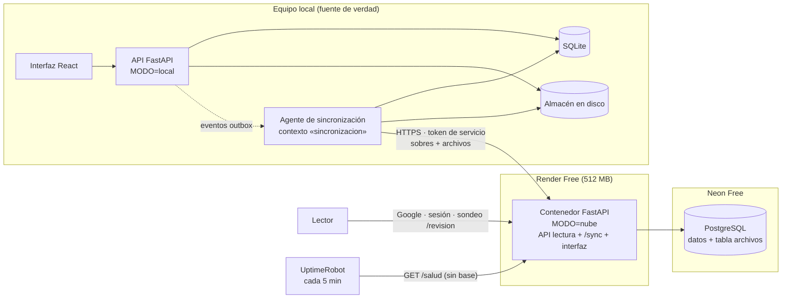

# Plan · Réplica completa en la nube (solo lectura, gratis) con sincronización automática

- Estado: **propuesto, v2** · Fecha: 2026-11-24 · Responsable: Pablo Andrés Erazo Muñoz
- Decisión asociada: `docs/decisiones/0009-nube-solo-lectura-y-sincronizacion.md`
- Cambios frente a la v1: la réplica incluye la **extracción completa** (no resúmenes); el alojamiento queda **decidido y
  gratuito**; no quedan decisiones abiertas, solo datos tuyos por aportar (sección 12).
- Tallas: **S** ≤ 1 día · **M** 2–4 días · **L** ≥ 1 semana (una persona, con pruebas)

## 1. Alcance cerrado

| Dentro | Fuera (por ahora) |
|---|---|
| Matriz, PDF, visor con resaltado de citas, **extracción completa** de cada artículo, libro de códigos | Extraer, cargar, aprobar, corregir o rechazar desde la nube |
| Sincronización automática local → nube, sin intervención | Claude en la nube (Fases 3–4, solo se dejan las costuras) |
| Panel de configuración local para definir el destino y ver el estado | Edición desde la nube; sincronización nube → local |
| Acceso solo para una lista de correos | Enlaces públicos |
| Costo: **0 USD/mes** | Dominio propio (usa la URL gratuita del proveedor) |

«Extracción completa» significa, sin excepciones: **todas las columnas** de cada corrida terminada de
`extraccion_extracciones` (`salida`, `codificacion_ciega`, `anclas`, `hallazgos`, `errores_validador`, `avisos_validador`,
`acuerdo_campos_criticos`, `iteraciones_validador`, `uso_tokens`, `datos_del_equipo`, `paso_fallido`, `error`, fechas),
más el documento estructurado y el crudo de MinerU de cada artículo. Hoy esos datos **no tienen ningún endpoint de
lectura** (la API solo expone `avance` y `modelos`), así que se agregan, en ambos modos (sección 6.4).

## 2. Decisiones cerradas

| Tema | Decisión | Razón |
|---|---|---|
| Fuente de verdad | El equipo local. La nube es réplica de solo lectura, salvo las búsquedas lanzadas en la web, que el equipo recoge (ADR 0012) | Sin conflictos que resolver |
| Qué se replica | **Todo el proyecto**, salvo cola de extracción, outbox, usuarios, registro/logs, copias `.db` antiguas y Excel exportados (se regeneran) | Réplica completa = la nube sirve de segundo resguardo (con la restauración de la Fase 2) |
| Extracciones en curso | Se replican solo al terminar (`COMPLETADA` o `FALLIDA`) | Evita reenviar cada pocos segundos el progreso de una corrida activa |
| Contenedor | **Render, plan Free** (Docker, desde GitHub `Zann181/calificar`) | Único host Docker gratuito vigente que verifiqué y que no exige cuenta de facturación como Cloud Run (si Render pidiera tarjeta al registrarte, ver sección 12) |
| Base de datos | **Neon, plan Free** (PostgreSQL) en AWS us-east-2 | 1 GB y sin la pausa semanal de Supabase (no verifiqué si Neon borra proyectos inactivos a largo plazo; el agente escribe con frecuencia y la réplica es desechable) |
| Archivos (PDF, crudo, Excel base) | **Dentro de PostgreSQL** (tabla `archivos`, `bytea`, clave = SHA-256) con un adaptador nuevo `AlmacenEnBase` | Un solo proveedor y una sola copia de seguridad; evita límites de 50 MB y dudas de compatibilidad S3 de otros planes gratuitos. Salida de emergencia en la sección 3.4 |
| Entrega del PDF | La API lo sirve con soporte de `Range` (mismo origen) | Sin CORS ni `withCredentials`; pdf.js funciona igual que en local |
| Subida de archivos | El agente los envía por la API (`PUT /sync/blobs/{sha}`), la nube verifica el hash | Sin URL firmadas de subida |
| Inicio de sesión | **Google** (OpenID: `openid email`) con lista de correos en `LECTORES_PERMITIDOS`; contingencia: GitHub OAuth | Gratuito, sin proveedor extra; `itsdangerous` (ya instalado) firma la cookie de sesión |
| Agente → nube | Token de servicio propio, guardado hasheado en la nube y en el Administrador de credenciales de Windows en local | Mínimo privilegio |
| Mantener despierto | UptimeRobot (gratis, cada 5 min) a `GET /api/v1/salud`, que **no toca la base** | Evita el sueño de 15 min de Render sin consumir horas de cómputo de Neon |
| Actualización del visor | Sondeo de `GET /api/v1/revision` cada 15 s con `ETag` | Coherente con el ADR 0007 (sin WebSocket) |
| Modo | `MODO=local` (hoy) o `MODO=nube`; una sola imagen | Un solo código |

## 3. Alojamiento gratuito

### 3.1 Qué se usa y qué dicen los planes (verificado el 2026-11-24; los planes gratuitos cambian, revísalos al registrarte)

| Servicio | Plan | Límite relevante | Lo que implica para nosotros |
|---|---|---|---|
| **Render** web service Free | 0 USD | 512 MB RAM, 0,1 CPU; **se duerme tras 15 min sin tráfico** y tarda ~1 min en despertar; 750 h/mes por cuenta; disco **efímero**; ancho de banda saliente mensual incluido (la cifra solo se ve en el panel) | Un solo servicio en la cuenta (744 h = 24/7). Nada de estado en disco. La app debe caber en 512 MB (sección 3.3) |
| **Neon** Free | 0 USD | 1 GB por proyecto; 100 horas-cómputo/mes; el cómputo se suspende a los 5 min sin consultas; restauración a un punto: 6 h | Datos de hoy ≈ 80 MB (8 % del cupo). El keepalive no debe consultar la base, o se gasta el cupo de cómputo |
| **UptimeRobot** Free | 0 USD | 50 monitores, intervalo de 5 min | Basta un monitor |
| **Google Cloud** (cliente OAuth) | 0 USD | Con alcances básicos (`openid`, `email`) no hace falta verificar la app | Pendiente de confirmar en la Fase 0 que crear el cliente no pide facturación |

### 3.2 Alternativas que se descartaron con datos

| Opción | Por qué no |
|---|---|
| Render Postgres gratuito | **Caduca a los 30 días**, 1 GB, sin copias |
| Supabase Free | 500 MB y **pausa el proyecto tras 1 semana con poca actividad de base de datos**; archivos de máx. 50 MB. Servible, pero con más piezas y una pausa que hay que vigilar |
| Oracle Cloud «Always Free» | En 2026 se reportó un recorte a 2 OCPU/12 GB y desactivaciones de instancias; fiabilidad dudosa |
| Hugging Face Spaces (Docker) | Informes de 2026 de que el CPU gratuito exige PRO pese a la documentación |
| Fly.io / Koyeb | Sin plan gratuito estable para cuentas nuevas (tarjeta y/o prueba corta) |
| Google Cloud Run | Gratuito con apagado a cero, pero exige cuenta de facturación con tarjeta |

### 3.3 Comportamiento esperado (sin sorpresas)

- **Primera carga tras un tiempo sin uso:** hasta ~1 min si Render durmió; con el monitor de 5 min no debería dormir, pero
  Render puede reiniciar un servicio gratuito en cualquier momento (cifra a medir en la Fase 1).
- **Primera consulta con la base suspendida:** una pequeña espera extra mientras Neon despierta.
- **Memoria:** `MODO=nube` no importa `pymupdf` (solo lo usa `extraccion/adaptadores/pdf.py`), ni crea ejecutor, despachador
  ni cliente de MinerU/Claude. Meta: **≤ 350 MB** de memoria en reposo, medida en la Fase 0.
- **Conexión a Neon:** punto de conexión con pool, `sslmode=require` y `prepare_threshold=None` en `psycopg`.

### 3.4 Salidas si cambian las reglas (todo por variables de entorno, sin reescribir)

| Si ocurre | Se hace |
|---|---|
| Los archivos superan ~400 MB en Neon | Nuevo adaptador de `AlmacenDeArchivos` hacia Cloudflare R2 (10 GB gratis; pide tarjeta) o Backblaze B2; el puerto ya existe y `AlmacenS3` ya está escrito. Script de migración de blobs |
| Render retira el plan gratuito o el keepalive molesta | Render *Starter* de pago o Cloud Run; misma imagen |
| Neon recorta el plan | Supabase Free, o Neon de pago; solo cambia `DATABASE_URL` |
| Google exige facturación para el cliente OAuth | Contingencia ya definida: GitHub OAuth (también gratuito) |

La nube es **desechable por diseño**: si se pierde, «Reenviar todo» la reconstruye desde el equipo local en minutos.

## 4. Arquitectura



## 5. Qué se replica

| Agregado | Origen local | Sobre | Tamaño hoy |
|---|---|---|---|
| Proyecto | `proyectos` | `proyecto` | — |
| Libro de códigos (todas las versiones) | `normas_versiones_libro` | `libro` | pequeño |
| Artículo | `biblioteca_articulos` | `articulo` | 53 filas |
| Documento estructurado | `biblioteca_documentos` | `documento` | 8,9 MB |
| Fila de la matriz **con sus celdas** (un solo agregado) | `matriz_filas` + `matriz_celdas` | `fila` | 3,8 MB |
| **Extracción completa** (25 columnas) | `extraccion_extracciones` terminadas | `extraccion` | 4,5 MB (59 corridas: 47 completadas, 12 fallidas) |
| Base de la matriz | `matriz_bases` | `base` | 1 fila |
| PDF | almacén `pdf/<proyecto>/<sha>.pdf` | archivo | 35 MB (máx. 3,4 MB) |
| Crudo de MinerU | almacén `crudo/<articulo>.zip` | archivo | 24 MB (máx. 2 MB) |
| Excel base | almacén `matrices/…` | archivo | 0,2 MB |
| Búsquedas terminadas, de ida y vuelta (ADR 0012) | `descubrimiento_busquedas` | `busqueda` | sin medir |
| Candidatos con sus hallazgos y análisis (ADR 0012) | `descubrimiento_candidatos` + `_hallazgos` + `_analisis` | `candidato` | sin medir |
| Perfiles de columnas (ADR 0012) | `descubrimiento_perfiles` | `perfil` | pequeño |
| **Total** | | | **≈ 80 MB** (8 % del cupo de Neon) |

**No se replica:** `extraccion_cola`, `outbox`, `usuarios`, `matriz_secuencias`, registro y logs, copias `.db`, Excel
exportados, extracciones sin terminar, búsquedas en curso ni la caché de «Buscar».

## 6. Sincronización

### 6.1 Sobre de réplica

```json
{ "esquema": 2, "tipo": "extraccion", "id": "<uuid>", "proyecto_id": "<uuid>",
  "hash": "sha256:…", "eliminado": false, "datos": { …todas las columnas… } }
```

- `hash` = SHA-256 del JSON canónico de `datos` (claves ordenadas, sin espacios). Mismo contenido → mismo hash.
- Cada contexto aporta `a_replica()` y `de_replica()` en sus adaptadores. `sincronizacion` **no lee tablas ajenas**; los
  conecta `app/composicion.py`.
- Un `esquema` que la nube no conoce → **426** y aviso en el panel («actualice la nube»).

### 6.2 Algoritmo del agente

```
disparadores:  eventos de outbox (agrupados 5 s) | temporizador 10 min | arranque | botón «Sincronizar ahora»

pasada(proyecto):
  0. GET /sync/pendientes → búsquedas lanzadas en la web: el equipo las recibe y desduplica (ADR 0012)
  1. local  = { (tipo,id): hash }  de todos los agregados replicables (extracciones: solo terminadas)
  2. nube   = GET /sync/manifiesto          → { revision, items }
  3. faltan = local − nube (ausente o hash distinto);  sobran = nube − local → eliminado:true
  4. archivos: por cada referencia nueva → HEAD /sync/blobs/{sha}; si falta → PUT bytes; la nube verifica el SHA-256
  5. sobres en lotes ≤ 1 MB, en orden: libro → artículo → documento → fila → extracción → base → búsqueda → candidato → perfil
  6. verificar: manifiesto de la nube == local; registrar la corrida
  error de red → espera creciente (5 s … 10 min); la app local nunca espera
```

- **Autorreparable:** nube vacía, restaurada o cortada a medias → la siguiente pasada la completa.
- **Cubre lo que los eventos no ven** (CLI, `importar-matriz`, `migrar-libro`): temporizador y arranque.
- **Sin tabla local de «lo enviado»:** la nube es la referencia; no hay dos contabilidades.
- Lotes de ≤ 1 MB y archivos de ≤ 3,4 MB respetan el límite de 512 MB de la nube; un documento estructurado (~175 KB) o una
  extracción (~80 KB) caben de sobra.

### 6.3 Protocolo en la nube (solo `MODO=nube`)

| Ruta | Quién | Qué hace |
|---|---|---|
| `GET /api/v1/sync/manifiesto?proyecto=` | token de servicio | hashes por agregado y `revision` |
| `HEAD /api/v1/sync/blobs/{sha}` · `PUT /api/v1/sync/blobs/{sha}` | token de servicio | existe / subir (verifica el hash) |
| `PUT /api/v1/sync/lote` | token de servicio | aplica los sobres en **una transacción**; `Idempotency-Key`; devuelve aceptados, rechazados y `revision` |
| `GET /api/v1/revision` | lector | entero que sube con cada lote; `ETag` |
| `GET /api/v1/capacidades` | lector | `{modo:"nube", escritura:false, …}` para ocultar controles |
| Todo endpoint de escritura de dominio | — | **405** |
| `POST …/candidatos/vista-previa` y `…/exportar` | lector | lecturas enviadas por POST: no dan 405 (ADR 0012) |
| `POST …/busquedas`, `…/busquedas/{id}/cancelar`, `…/busqueda/fuentes/{f}/reactivar` | lector | lo único que se escribe desde la web; 403 si viene de otro origen (ADR 0012) |
| `GET /api/v1/sync/pendientes?proyecto=` | token de servicio | búsquedas web terminadas que el equipo aún no recibió |

El `PUT /lote` usa casos de uso de importación de cada contexto; no escribe tablas ajenas. Un archivo se publica antes
que el artículo que lo referencia: la nube nunca muestra un artículo sin su PDF.

### 6.4 Lectura de la extracción completa (nuevo, en ambos modos)

- `GET /api/v1/proyectos/{p}/extracciones` → lista sin cuerpos (id, artículo, estado, fechas, acuerdo, iteraciones, modelos).
- `GET /api/v1/proyectos/{p}/extracciones/{id}` → registro completo, con todas las columnas.
- Interfaz: en la ficha de cada artículo, una sección **«Extracción»** de solo lectura con pestañas: *Salida*,
  *Codificación ciega*, *Anclas*, *Hallazgos*, *Validador* (errores, avisos, iteraciones), *Uso de tokens*, *Datos del
  equipo*. Las anclas enlazan al visor de PDF en la página y el rectángulo.
- `avance` y `modelos` siguen siendo del modo local; en la nube `modelos` se calcula desde las extracciones replicadas.

### 6.5 Fallos y garantías

| Situación | Comportamiento |
|---|---|
| Sin internet | La app local sigue normal; el panel muestra «N cambios pendientes»; reintenta sola |
| Corte a mitad | Lotes transaccionales; la siguiente pasada completa |
| Mismo lote dos veces | Idempotente (`hash` + `Idempotency-Key`) |
| Fila reemplazada o artículo excluido | Se envía `eliminado:true` y la nube lo quita |
| Local más nuevo que la nube | 426 y aviso; se despliega primero la nube |
| Render dormido | El agente reintenta; el primer intento lo despierta |
| Neon agotó el cupo de cómputo del mes | La API responde 503 con mensaje claro; el agente reintenta; se muestra en el panel |
| Dos equipos sincronizando el mismo proyecto | 409 (la nube guarda el id de instalación del primero) |

### 6.6 Visor vivo

Sondeo de `/revision` cada 15 s con `ETag`; si sube, se invalidan las consultas de `react-query`. Texto fijo: «Actualizado
hace 12 s · revisión 345»; aviso si pasan 15 min sin recibir nada. Latencia local → visor: **≤ 30 s** con la nube despierta.

## 7. Panel de configuración (interfaz local, «Configuración › Nube»)

1. **Destino:** **URL de la nube** (`https://….onrender.com`), **Token de sincronización** (campo oculto), botón **Probar
   conexión** (comprueba URL, token, versión de esquema, nube despierta, base disponible y dice qué falló), enlace **Abrir visor**.
2. **Qué se sube:** interruptores, todos activados por defecto: PDF, documento estructurado, matriz y evidencias,
   historial de revisiones, **extracción completa**, crudo de MinerU, Excel base.
3. **Cuándo:** automático (sí) · agrupar cambios 5 s · reconciliar cada 10 min · **Pausar**.
4. **Estado:** indicador en la cabecera: `✔ Sincronizado hace 8 s` · `↻ Subiendo 3 de 12` · `⚠ Sin conexión · 4 pendientes` ·
   `✖ Error: …`. Tabla de las últimas corridas. Botones: **Sincronizar ahora**, **Verificar integridad**, **Reenviar todo**.

Reglas: el token va al **Administrador de credenciales de Windows** (`keyring`, clave por `proyecto_id`) y la API local
**nunca** lo devuelve; los ajustes no secretos viven en la base local (`sync_destinos`), así *principal* y *test* no se
mezclan; una nube mal configurada o caída **nunca** impide usar la app. Tablas nuevas con migración Alembic:
`sync_destinos`, `sync_corridas`. Rutas locales: `/api/v1/sincronizacion/{ajustes,probar,ahora,verificar,estado,corridas}`.

## 8. Seguridad

| Tema | Decisión |
|---|---|
| Lectores | Google → correo en `LECTORES_PERMITIDOS`; sin sesión, 401 y pantalla de acceso |
| Agente | Token de servicio con permiso solo para `/sync/*`; hasheado en la nube; rotable |
| Falla cerrada | `MODO=nube` no arranca sin cliente OAuth, lista de lectores y token de servicio; el «administrador local» no se registra |
| PDF | Solo con sesión; sin enlaces públicos; `Cache-Control: private` |
| Derechos de autor | Los PDF son artículos de terceros: la nube se mantiene privada y limitada a la lista (asesores, jurados) |
| Secretos | Variables de entorno de Render y `keyring` local; nada en el repositorio, ni en logs, ni en el panel |
| Transporte | Solo HTTPS (el agente rechaza `http://` salvo `localhost`) |
| Datos del equipo | `datos_del_equipo` y `uso_tokens` viajan con la extracción: otra razón para la lista cerrada de lectores |

## 9. Fases

### Fase 0 · Compuertas (esfuerzo total: M). Si una falla se usa su plan B y se continúa

| # | Prueba | Talla | Pasa si | Si falla |
|---|---|---|---|---|
| 0.1 | CI con servicio PostgreSQL 16: `alembic upgrade head`, `alembic check`, `pytest` | M | verde en SQLite y PostgreSQL | se corrigen JSONB/índice parcial; no se avanza sin esto |
| 0.2 | Imagen Docker en `MODO=nube` desplegada en Render Free contra Neon | M | `/salud` responde; memoria en reposo ≤ 350 MB; migraciones aplican | quitar dependencias del arranque; si no cabe, plan de pago de Render |
| 0.3 | `AlmacenEnBase`: guardar y leer 60 MB de archivos con `Range` | S | un PDF de 3,4 MB se sirve y pdf.js lo abre | R2 con `AlmacenS3` (sección 3.4) |
| 0.4 | Cliente OAuth de Google sin facturación, con la lista de correos | S | inicia sesión un correo permitido y se rechaza otro | GitHub OAuth |
| 0.5 | Monitor de UptimeRobot a `/salud` durante 48 h | S | el servicio no se duerme y Neon se suspende en reposo | aceptar el despertar de ~1 min y mostrarlo en el panel |

**Resultado de la Fase 0 (2026-11-24, en el equipo local; PostgreSQL 16.2 embebido, sin Docker):**

| # | Estado | Evidencia |
|---|---|---|
| 0.1 | **Pasa en local** | Migraciones 0001→0006 y `alembic check` limpios en PostgreSQL; 286 pruebas verdes en SQLite **y** en PostgreSQL (`PRUEBAS_POSTGRES_URL`, un esquema por prueba). Falló una cosa real: `migrations/env.py` rompía con cualquier URL con `%` (contraseñas codificadas como las de Neon); corregido. El job de CI quedó escrito pero **no corre en GitHub** (ver nota abajo) |
| 0.2 | **Pasa a medias** | `MODO=nube` arranca sin hilos de fondo y sirve la interfaz y la API sobre PostgreSQL con los datos reales (79 filas, 59 extracciones, 53 PDF): **≈ 100 MB en reposo y ≈ 135 MB tras abrir 15 documentos y 15 PDF** (Windows, Python 3.13; meta ≤ 350 MB). `pymupdf` pasó a importarse al usarlo. **Falta:** construir la imagen (`Dockerfile` escrito, sin probar: no hay Docker aquí) y desplegar en Render contra Neon |
| 0.3 | **Pasa en local** | `AlmacenEnBase` (+ tabla `biblioteca_archivos`, migración 0006): 60 MB en 107 archivos se guardan y leen en 1,4 s; el endpoint del PDF soporta `Range` (206/416); en el navegador pdf.js abrió el PDF servido desde la base (capa de texto de 387 fragmentos, sin errores). **Falta:** medirlo contra Neon real (latencia de red) |
| 0.4 | **Pendiente de ti** | Necesita tu cuenta de Google Cloud |
| 0.5 | **Pendiente de ti** | Necesita Render desplegado y tu cuenta de UptimeRobot |

Nota sobre el CI: la raíz del repositorio git es `calificar/`, y GitHub solo ejecuta flujos de `calificar/.github/workflows/`.
El `ci.yml` vive en `extractor-matriz/.github/workflows/`, así que **hoy ningún CI corre en GitHub**. Moverlo a la raíz
(con `working-directory: extractor-matriz/backend`) es una decisión tuya porque empezaría a ejecutarse en cada `push`.

Cambios añadidos por la Fase 0: `MODO` y `ALMACEN_EN_BASE` en `config.py`; `DATABASE_URL` acepta `postgresql://` y
`postgres://` (como las entrega Neon) y el motor desactiva las sentencias preparadas (pool de Neon); `Dockerfile`,
`.dockerignore` y `.env.nube.example`.

### Fase 1 · Réplica completa de solo lectura (esfuerzo total: L)

| # | Tarea | Talla | Aceptación |
|---|---|---|---|
| 1.1 | `MODO=nube`: rutas de escritura → 405; `/capacidades`; la interfaz oculta extraer, cargar, restablecer, aprobar/corregir/rechazar, monitor de Claude/servicios y registro | M | recorrido completo del visor sin ningún botón de escritura |
| 1.2 | Inicio de sesión de lectores + token de servicio; falla cerrada | M | 401 sin sesión; el token no lee; el lector no escribe; sin configuración no arranca |
| 1.3 | `a_replica()/de_replica()` por contexto, hash canónico, `esquema: 1` | M | ida y vuelta idéntica, incluida la extracción completa (extiende `test_ida_y_vuelta_matriz`) |
| 1.4 | Endpoints de lectura de extracciones y sección «Extracción» (6.4), en ambos modos | M | los 59 registros se ven completos en local y en nube |
| 1.5 | Ingesta en nube: `manifiesto`, `blobs`, `lote`, `revision` | M | idempotente, transaccional, 426 |
| 1.6 | Agente local (contexto `sincronizacion`) + migraciones `sync_destinos`, `sync_corridas` | L | pasada completa de 79 filas, 59 extracciones, 53 artículos con su PDF, 51 documentos y todos los crudos existentes; segunda pasada = 0 envíos |
| 1.7 | Panel de configuración e indicador de cabecera | M | probar, sincronizar, verificar y pausar funcionan; el token no aparece en ninguna respuesta |
| 1.8 | Visor vivo: sondeo de `/revision` y aviso de actualización | S | aprobar una celda en local → visible en la nube en ≤ 30 s |
| 1.9 | Despliegue continuo desde `main` en Render; publicación inicial | S | manifiestos local y nube idénticos |

**Resultado de la Fase 1 (2026-11-24, en el equipo local; la nube de prueba fue un segundo servidor con SQLite):**

| # | Estado | Evidencia |
|---|---|---|
| 1.1 | **Hecha** | `MODO=nube`: toda escritura de dominio → 405 (guardia en `app/modo_nube.py`); `/capacidades`; la interfaz oculta cargar, extraer, restablecer, continuar, aprobar/corregir/rechazar, exportar, registro y monitor de servicios (verificado en el navegador) |
| 1.2 | **Hecha** | Google OAuth escrito (código → `id_token` por TLS) y probado con un intercambio simulado; lista `LECTORES_PERMITIDOS`; 401 sin sesión, el token de servicio no lee, el lector no usa `/sync`; sin las seis variables de acceso la nube no arranca. **No probado contra Google real** (compuerta 0.4). La contingencia GitHub no se escribió |
| 1.3 | **Hecha** | `adaptadores/replica.py` en cada contexto + `compartido/sobre.py` (hash canónico, `esquema: 1`). Réplica a nivel de fila SQL con todas las columnas, no de objetos de dominio |
| 1.4 | **Hecha** | `GET /extracciones` (lista sin cuerpos, filtro `?articulo=`) y `GET /extracciones/{id}` (completa), en ambos modos; ficha «Extracción» con las siete pestañas y enlace al PDF desde cada ancla |
| 1.5 | **Hecha** | `/sync/{salud,manifiesto,archivos,lote}` + `/revision` con ETag; lote transaccional e idempotente; 426 con esquema mayor; 409 si otra instalación sincroniza |
| 1.6 | **Hecha, medida con los datos reales** | Copia de `datos/extractor.db`: 1.ª pasada = 248 sobres (79 filas, 59 extracciones, 53 artículos, documentos, libro, base) + 105 archivos (61 MB) en 15 s, con verificación posterior; **2.ª pasada = 0 envíos** (4,5 s) |
| 1.7 | **Hecha** | Panel «Configuración › Nube» con probar, guardar, qué se sube, pausar, sincronizar ahora, verificar, reenviar todo y tabla de corridas; indicador en la cabecera; el token solo se escribe (la API devuelve `token_guardado`) |
| 1.8 | **Hecha** | Aprobar una celda en local → visible en la nube a los ~11 s (agrupación de 5 s + pasada). El visor sondea `/revision` cada 15 s y recarga los datos |
| 1.9 | **Pendiente de ti** | Necesita Render, Neon y las cuentas de la sección 12 |

Pruebas: 321 verdes en SQLite (35 nuevas: réplica bit a bit de las 25 columnas de la extracción, paridad de la API local y nube,
recuperación, borrado, fila reemplazada, extracción en curso, opciones, 409, 426, seguridad, OAuth, agente con reloj falso).
**No se corrieron sobre PostgreSQL** en esta sesión (sin servidor disponible); el job de CI sigue sin ejecutarse en GitHub.

Diferencias con lo planeado, todas menores:

- Rutas locales bajo `/api/v1/proyectos/{id}/sincronizacion/*`, como el resto de la API.
- Los archivos se identifican por su **clave del almacén** (`pdf/…`, `crudo/…`, `matrices/…`) con su SHA-256 verificado, no por el
  SHA-256 solo; la nube no borra archivos.
- Un artículo excluido se replica con su estado `EXCLUIDO` (no se envía `eliminado:true`), para que la nube y el equipo sean idénticos.
- La reconciliación y la agrupación se guardan por proyecto en `sync_destinos`, pero el panel solo muestra sus valores.
- En teléfono el indicador de la nube sale arriba del contenido, no en la cabecera.
- `python -m app.cli token-sync` genera el token del agente y el `SYNC_TOKEN_HASH` de la nube.

### Fase 2 · Resguardo y comodidad (M–L)

| # | Tarea | Estado | Evidencia |
|---|---|---|---|
| 2.1 | **Descargar proyecto desde la nube** | **Hecha** | Panel (sección 5) y `python -m app.cli restaurar-nube`. Muestra primero el plan (faltan, difieren, solo aquí) y no borra nada local; con diferencias se rehúsa hasta pedir «reemplazar». Baja archivos y luego sobres en una transacción y verifica que quedó idéntico. En un equipo vacío la API responde igual que la del original; en la copia real: 30 filas perdidas → «Restaurado: 30 elementos», siguiente pasada sin envíos |
| 2.1b | **Valla contra el desastre** (no estaba en el plan) | **Hecha** | Sin ella, un equipo que perdió datos habría **borrado la nube** en su siguiente pasada. Ahora, si «sobran» en la nube más de 10 elementos y más del 10 %, la pasada se detiene con un aviso; solo «Reenviar todo» lo permite |
| 2.2 | **Eventos del servidor (SSE)** | **Hecha** | `GET /api/v1/eventos`: el visor recibe la revisión nueva al instante (en la prueba, 2 s después de terminar la pasada); latido cada 15 s; el sondeo de `/revision` queda de respaldo si la conexión cae. El aviso viaja en memoria, sin consultar la base |
| 2.3 | **Exportar Excel desde la nube** | **Hecha** | `GET /exportaciones/matriz.xlsx` genera el libro al vuelo (no guarda nada); mismas hojas y celdas que el del equipo local |
| 2.4 | **Lectores desde el panel** | **Hecha** | Sección 6 del panel: alta y baja que rigen al instante (también una sesión ya iniciada pierde el acceso). Los de `LECTORES_PERMITIDOS` son fijos y solo se quitan en Render. Tabla `sync_lectores` (migración 0008) |
| 2.5 | **Paginación y búsqueda en servidor** | **Aplazada** | Con 79 filas y 53 artículos `tam=500` no es un problema; cambiar la grilla a un modelo de filas por demanda es un cambio grande sin beneficio hoy. Se retoma si la matriz pasa de unos cientos de filas |

Pruebas nuevas: restauración (equipo vacío, diferencias, choque de nombre de proyecto, en segundo plano, endpoints con token),
valla, Excel, lectores, SSE (difusor, flujo y aviso al aplicar un lote).
**Sin correr sobre PostgreSQL**, como la Fase 1.

Notas:

- La restauración sobre un equipo nuevo debe hacerse **sin correr «semilla»** (el nombre del proyecto es único y la semilla le
  pone otro identificador): el mensaje de error lo explica.
- Restaurar no dispara eventos ni sincroniza hacia la nube mientras corre.
- El panel pide el plan sin cambiar nada; recalcula todo al bajar (unos segundos con 61 MB de archivos).

### Fase 3 · Claude en la nube (futuro)

**Decisión del responsable (2026-11-25): no se hace por ahora.** La extracción sigue solo en el equipo local y la nube queda
como visor y respaldo. Si se retoma, las preferencias ya dadas son: **MinerU sigue en el equipo local** (a la nube solo
llegan los documentos ya convertidos) y la nube escribiría **únicamente extracciones nuevas** con las filas que generan
(aprobar y corregir siguen en local, casi sin conflictos); falta decidir el acceso a Claude (token de larga duración con
la CLI, que mantiene el ADR 0002, o clave de API, que lo reemplaza) y el tope de gasto.

Reabrir el ADR 0002 (la CLI con sesión no existe en un contenedor: clave de API o SDK de agentes, con tope de gasto);
worker que consuma `extraccion_cola` (ya en base) con `FOR UPDATE SKIP LOCKED`; MinerU como servicio aparte (11–21 s por
página en CPU y ~7,7 GB de RAM: **no cabe en ningún plan gratuito**, saldrá del cupo gratuito); `version` por fila para
concurrencia optimista. **Esta fase deja de ser gratuita.**

### Fase 4 · Cambio de sede (futuro)

Operación explícita «Mover la sede a la nube»: última pasada local, `sede = nube` con valla de `revision`, y la nube pasa
a ser la escritora. Sin fusión bidireccional.

## 10. Costuras para Fases 3–4 que ya existen o se dejan hoy

IDs UUID y `proyecto_id` en todo (existe) · puerto `AlmacenDeArchivos` con adaptadores intercambiables (existe, se añade
`AlmacenEnBase`) · outbox y `extraccion_cola` en base (existen) · API sin estado en nube (1.1) · `sede` por proyecto en
`sync_destinos`, con solo `local` permitido (1.6) · `autor` de cada revisión = correo, que ya coincide con el correo de
Google. **No se agrega `version` por fila hasta la Fase 3.**

## 11. Pruebas

1. **Paridad local/nube** (la central): tras sincronizar contra una nube de prueba (`TestClient`; en el CI de 0.1 también
   PostgreSQL), las respuestas de `/matriz/filas`, `/celdas/{clave}`, `/articulos`, `/documento`, `/normas/columnas`,
   `/extracciones` y `/extracciones/{id}` son **idénticas**.
2. **Extracción completa:** las 25 columnas de cada una de las 59 corridas coinciden bit a bit tras la ida y vuelta.
3. **Idempotencia:** segunda pasada sin envíos; mismo lote y misma `Idempotency-Key` → mismo resultado.
4. **Recuperación:** corte a mitad, nube vaciada, fila alterada en la nube → la pasada siguiente iguala los manifiestos.
5. **Borrado:** una fila reemplazada o un artículo excluido desaparecen de la nube.
6. **Extracciones en curso:** no se envían hasta terminar; al terminar, sí.
7. **Esquema:** `esquema` mayor → 426 y el panel lo explica.
8. **Seguridad:** 401 sin sesión; el token de servicio no lee; el lector no escribe; escritura de dominio → 405; sin
   configuración no arranca; el token no aparece en respuestas ni logs.
9. **Recursos:** memoria ≤ 350 MB en reposo; PDF de 3,4 MB servido con `Range`.
10. **Arquitectura:** contrato de `import-linter` — `sincronizacion` no importa adaptadores ni tablas de otros contextos.
11. **Manual de extremo a extremo:** aprobar una celda y verla en ≤ 30 s; apagar el internet, aprobar tres, reconectar y
    verificar que llegan.

## 12. Lo que necesitas aportar (no son decisiones: son datos y cuentas)

| # | Qué | Para qué |
|---|---|---|
| 1 | Crear cuenta en **Render**, **Neon** y **UptimeRobot** (gratis); conectar Render con el repositorio `Zann181/calificar`. Si alguno pide tarjeta, avísame antes de ingresarla: ese dato lo pones tú | Fase 0.2 y 0.5 |
| 2 | Lista de **correos de lectores** (con cuenta Google; si alguien no tiene, GitHub) | Fase 0.4 |
| 3 | Confirmar que **solo** la base principal se publica (el conjunto de test no) | Fase 1.9 |
| 4 | Aceptar que los PDF quedan en una nube **privada** con la lista cerrada (sección 8) | Seguridad |

## 13. Riesgos

| Riesgo | Prob. | Impacto | Mitigación |
|---|---|---|---|
| El código no corre limpio en PostgreSQL | Media | Alto | Compuerta 0.1 |
| 512 MB de RAM no alcanzan | Media | Alto | Compuerta 0.2; `MODO=nube` ligero; plan de pago de Render si hiciera falta |
| Un plan gratuito cambia o desaparece | Media | Medio | Salidas de la sección 3.4; réplica desechable |
| Despertar de ~1 min molesta a los lectores | Media | Bajo | Keepalive; aviso visible; nota en el enlace que se comparte |
| Se agota el cómputo de Neon (100 h/mes) | Baja | Medio | `/salud` sin base; agente con reintento; mensaje claro |
| Derechos de autor de los PDF | Media | Alto | Lista cerrada, sin enlaces públicos |
| Esquemas desalineados tras el `git pull` automático del lanzador | Media | Medio | Nube primero; 426 y aviso |
| Credenciales filtradas | Baja | Alto | `keyring`, token de un solo permiso, rotación desde el panel |

## 14. Fuentes consultadas el 2026-11-24

- Render: [Deploy for Free](https://render.com/docs/free), [Compute plans](https://render.com/docs/compute-plans), [Postgres gratuito caduca a los 30 días](https://render.com/changelog/free-postgresql-instances-now-expire-after-30-days-previously-90)
- Neon: [Planes](https://neon.com/pricing), [Límites del plan gratuito](https://neon.com/faqs/free-plan-limits-and-quotas), [Ventana de historial](https://neon.com/docs/introduction/history-window)
- Supabase: [Pausa de proyectos gratuitos](https://supabase.com/docs/guides/platform/free-project-pausing), [Límite de archivos](https://www.supabase.com/docs/guides/storage/uploads/file-limits)
- UptimeRobot: [Intervalo de monitoreo](https://help.uptimerobot.com/en/articles/11360876-what-is-a-monitoring-interval-in-uptimerobot/)
- Google: [Audiencia de la app OAuth](https://support.google.com/cloud/answer/15549945)
- Oracle: [Recorte de Always Free (InfoQ)](https://infoq.com/news/2026/07/oracle-cloud-free-tier-limits/)
- Cloudflare R2: [Precios](https://developers.cloudflare.com/r2/platform/pricing/)
